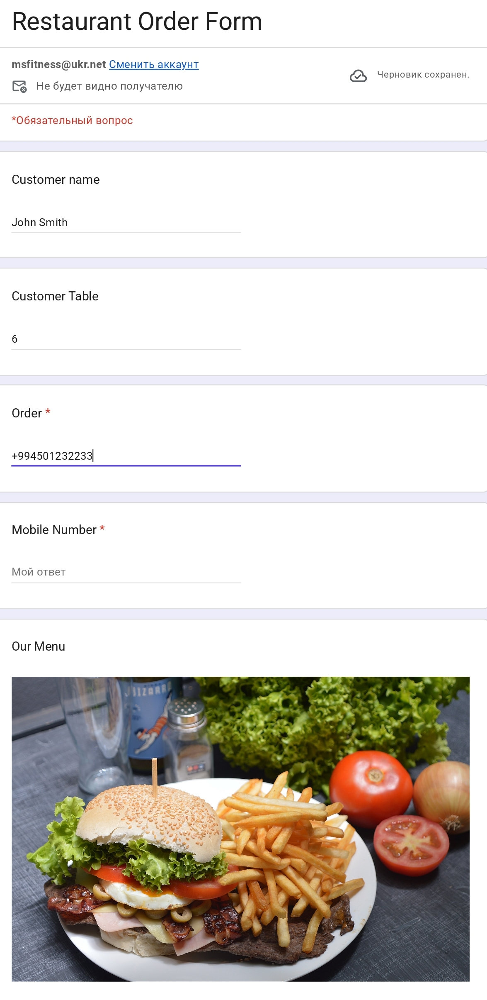
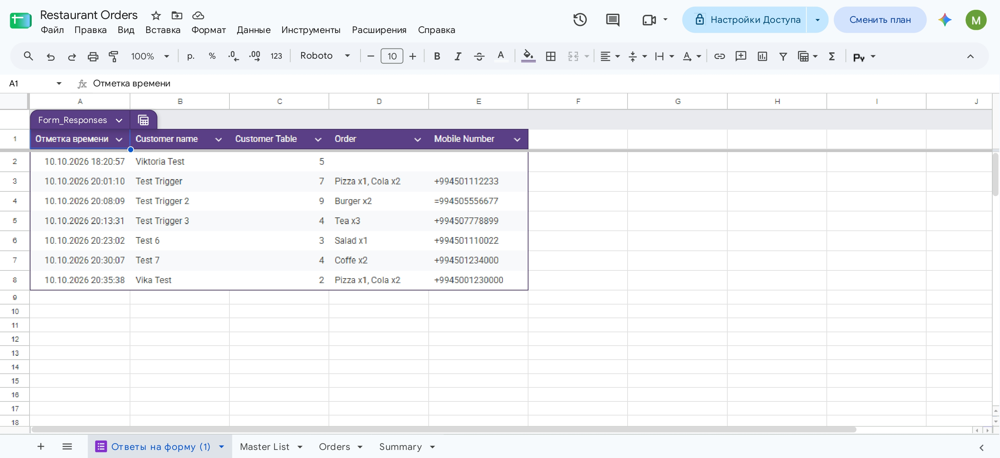
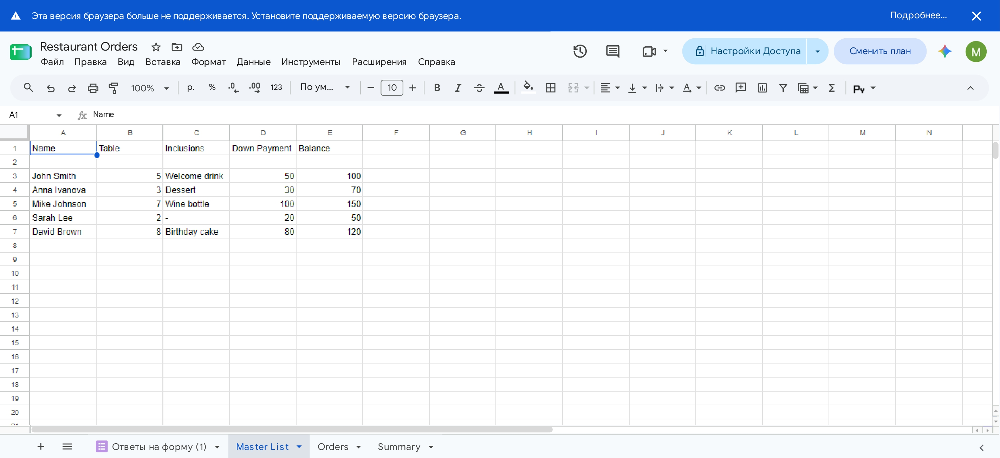

# 🍽️ Restaurant Order System

An automated order management system for restaurants built with **Google Forms**, **Google Sheets**, and **Google Apps Script**.

## 🎯 What it does

Customers submit their order through a Google Form. The system automatically:

- Splits multi-item orders into separate rows (1 row = 1 dish)
- Assigns a unique Order ID to each order
- Records the order in the Orders sheet
- Updates the Summary sheet in real time

The kitchen staff can update each dish's status (New / Fulfilled / Cancelled / Rejected).

## 🧩 Components

| Component | Purpose |
|-----------|---------|
| **Google Form** | Customer fills in: name, table, order, phone |
| **Master List** | Pre-existing reservations (name, table, prepayment, balance) |
| **Orders Sheet** | Structured orders — one row per dish |
| **Summary Sheet** | Auto-calculated totals per table |
| **Apps Script** | Backend logic — splits order, assigns ID, writes to sheet |

## 🔄 How it works

1. Customer opens the form
2. Fills in the order (e.g. `Pizza x1, Cola x2`)
3. Clicks Submit
4. Apps Script triggers automatically (`onFormSubmit`)
5. The order is split into separate rows — one per dish
6. All rows share the same Order ID
7. Summary sheet recalculates totals for each table

## 🛠️ Technologies

- Google Forms
- Google Sheets
- Google Apps Script (JavaScript)

## 📸 Screenshots

### Order Form (filled)

### Form Responses

### Master List

## 👤 Author

**Viktoria Zykova** — Junior Python / AI Developer

- GitHub: [@ViktoriaFit](https://github.com/ViktoriaFit)
- Email: msfitness@ukr.net
